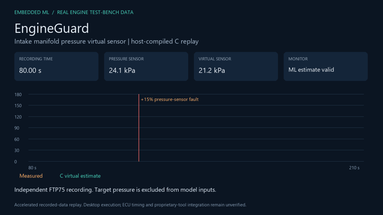
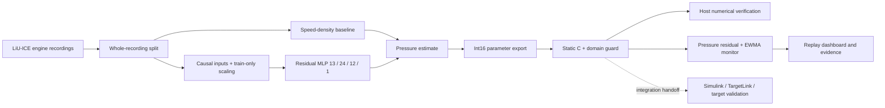
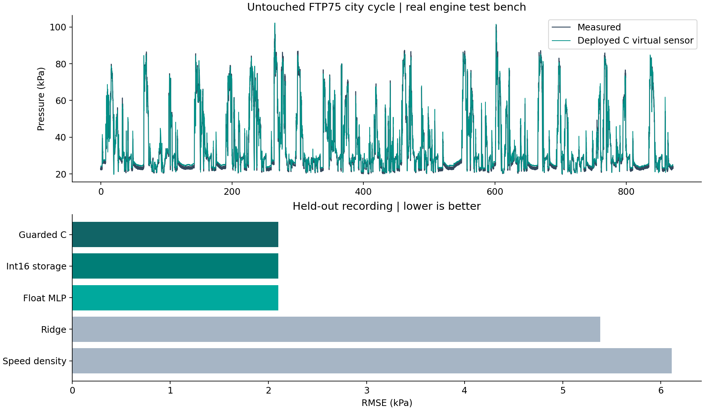
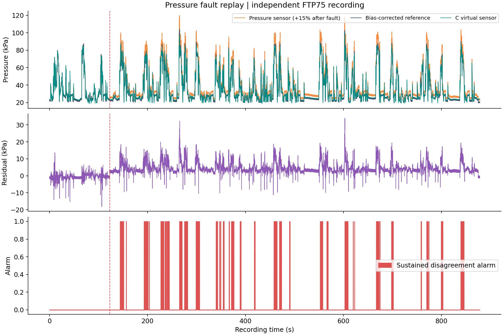

# EngineGuard — Embedded ML for Engine Air-Path Development

**A pressure virtual sensor built from real engine test-bench data, exported to portable C, and evaluated through a working replay dashboard.**

EngineGuard investigates a practical question: can a small learned model complement a physics-inspired engine estimator while remaining easy to integrate, inspect and maintain in an embedded development workflow?

It estimates intake manifold pressure from six other engine signals, then monitors disagreement with the physical pressure sensor. The implementation combines a speed-density baseline with a compact residual neural network, int16 parameter storage, guarded inference, and explicit diagnostic state.

## See it working



**[Watch the 36-second MP4 demonstration](media/demo.mp4)** · [Measured results](reports/RESULTS.md) · [Research and sources](docs/RESEARCH.md) · [Model-based integration](integration/README.md)

The video is generated from actual host-compiled C output on an independent FTP75 engine recording. It shows recorded data at accelerated speed with explanatory captions; it is not a physical ECU demonstration. The dashboard supports play/pause, seeking, playback speed, and four nominal/fault scenarios.

## Measured results

| Evidence | Result |
|---|---:|
| Independent nominal test recording | 17,423 samples at approximately 20 Hz |
| Speed-density baseline RMSE | 6.109 kPa |
| Ridge regression RMSE | 5.381 kPa |
| Deployed guarded C estimator RMSE | **2.100 kPa** |
| RMSE reduction versus speed-density | **65.6%** |
| Deployed estimator R² | **0.9837** |
| Quantized model parameter storage | **1,372 bytes** |
| Parameter storage reduction versus float32 | **47.1%** |
| Maximum valid-input Python/C difference | **0.095 Pa** |
| Median of five host batch-mean timings | **1.128 μs/call** |
| Nominal test alarm fraction after 10 s | **0% on this recording** |

Timing includes estimator and monitor on the recorded Windows/MinGW host; it excludes text I/O. It is not ECU timing, WCET or a hard real-time guarantee. State uses 36 bytes on the host ABI; complete target stack, RAM and flash measurements remain pending. Parameter storage excludes normalization arrays, scalar constants, code and runtime state. See [machine-readable metrics](reports/metrics.json) for the complete environment, five timing batches, and every fault recording.

## Why it fits embedded engine-control development

| Development concern | Project evidence |
|---|---|
| Engine application | Real turbocharged-engine air-path measurements; pressure estimation and sensor disagreement monitoring |
| Machine learning | Train-only scaling, causal features, residual ReLU network, validation-based architecture selection |
| Physics + data | Fitted speed-density baseline plus learned residual correction; comparison with ridge regression |
| Computation | Fixed-size C loops, no heap allocation, no inference runtime dependency, host timing harness |
| Memory | Int16 weight export with float arithmetic; parameter accounting and compiled-object report |
| Model-based workflow | 50 ms interface contract, Simulink C Caller harness-generation script, TargetLink external-code handoff |
| Verification | Whole-recording split, Python/C parity, defensive-input checks, held-out fault replay, CI workflow |
| Maintainability | Explicit caller-owned state, model/source hashes, dataset manifest, model artifact and reproducible commands |

**Verified here:** Python training, GCC compilation, host execution, replay dashboard, numerical checks, charts and video. **Prepared for later validation:** Simulink execution, TargetLink code generation, PIL/HIL and ECU deployment. There is no claim of production readiness, emissions reduction, fuel savings, Volvo data access, or official benchmark ranking.

## Run locally

Requires Python 3.11–3.13, GCC on `PATH`, and Git. The published run used Python 3.13.4. GNU `size` is needed for the full pipeline object report. On Windows, MinGW provides `gcc` and `size`; on Ubuntu use the standard build-essential/binutils packages.

```bash
git clone https://github.com/Pavan-amikula/engine-guard.git
cd engine-guard
python -m venv .venv
# Windows PowerShell: .venv\Scripts\Activate.ps1
# Linux/macOS: source .venv/bin/activate
python -m pip install -r requirements-lock.txt

# Fast: compile and verify the supplied model without downloading engine data
python src/verify.py

# Full: acquire data, train, export, evaluate, and run the demo
python src/data.py
python src/pipeline.py
python src/make_demo.py
python src/serve.py
```

Open **http://127.0.0.1:8765**. Keep the terminal running; Ctrl+C stops the server. The server binds only to loopback. Its API invokes the C replay executable, then caches the resulting recorded trace for playback. It does not stream a physical engine or retrain during playback.

The data download is about 61 MB. Training three small networks typically takes minutes on a desktop. Each candidate uses a fixed 180-epoch budget; convergence warnings are retained, and an optimal solution is not claimed. For repeatable single-threaded training, set `OPENBLAS_NUM_THREADS=1` before starting Python. Minor numerical and timing differences across platforms are expected.

## Architecture



Six current inputs and their one-sample delays form twelve features. A thirteenth feature is `air_mass_flow × intercooler_temperature / engine_speed`. The supervised pressure and its past values are excluded. The fitted baseline uses this speed-density-inspired feature; the neural network learns the baseline residual. Each layer's weights are stored as int16 with a layer scale and used in floating-point arithmetic.

The guard checks finite/physical values and training-derived bounds for current and delayed inputs. Out-of-envelope operation uses a clipped baseline and disables the residual monitor. Invalid physical inputs reset state; callers must check status before using outputs. This fallback is a prototype policy requiring engineering review before control-system use.

## Evaluation without adjacent-row leakage

| Role | Recording | Samples |
|---|---|---:|
| Fit model and preprocessing | `wltp_NF.csv` | 36,068 |
| Select architecture and monitor threshold | `wltp_NF_2.csv` | 36,183 |
| Final nominal holdout | `ftp75city2_NF.csv` | 17,423 |
| Final fault replay | All 18 `ftp75city2_f_*.csv` files | Per-file results retained |

These files come from the benchmark's public training archive. The holdout is defined by this project and is not the official hidden competition test. [The dataset manifest](reports/data_manifest.json) records archive and per-file SHA-256 hashes. Separate driving recordings limit adjacent-sample leakage but do not prove transfer to another engine.



## Fault demonstration and limitations



For the +15% manifold sensor fault, the virtual estimate achieves **1.396 kPa MAE** against a reference reconstructed using the documented multiplicative fault law, versus **5.165 kPa** for the biased sensor. This reconstructed reference is not a second independent hardware measurement. The conservative monitor first alarms **21.21 s** after onset and alarms for **14.89%** of post-fault samples.

The −5% manifold fault is missed; +5% sensitivity is weak. Airflow faults can corrupt an estimator input, and disagreement does not isolate which component failed. The complete results include these failures. Improving sensitivity requires a separately validated detector design, not tuning on this final test. No closed-loop engine controller or sensor-replacement safety case is demonstrated.

## Repository guide

```text
embedded/        Portable inference, explicit state, model constants and host harness
src/             Data acquisition, training/export, checks, replay server, video rendering
models/          Selected quantized weights, scaling, bounds and baseline coefficients
dashboard/       Interactive local recorded-data viewer
integration/     Simulink generation script and TargetLink handoff contract
reports/         Results, metrics, hashes, object-size and stack-measurement boundaries
media/           Demonstration MP4/GIF and evaluation plots
docs/            Research sources, requirements mapping and interview/resume handoff
.github/         Reproduction CI and downloadable evidence artifact
```

## Sources and attribution

The engine measurements originate from Jung, Frisk and Krysander's [LiU-ICE benchmark](https://arxiv.org/abs/2408.13269) and the [official benchmark resource page](https://vehsys.gitlab-pages.liu.se/dx_benchmarks/liuice/liuice_index). Related research and the specific ideas adapted are documented in [RESEARCH.md](docs/RESEARCH.md). The implementation does not copy the benchmark's analytical engine model or third-party project code. Raw data and generated replay CSVs are excluded from Git because an explicit raw-data redistribution license was not identified. Source code uses the MIT license; that license does not cover third-party measurements.
